
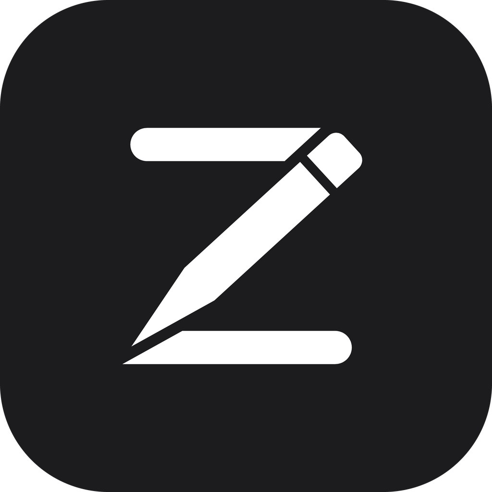

<h1 align="center">Zobou</h1>

<b>The trading journal that runs on your PC. Your data stays with you.</b>

<a href="README.md">🇫🇷 Français</a> · 🇬🇧 English

---

> **Current price: $30 (launch price), one-time payment.** No subscription. **12 months of updates included.**
> The price goes up by $20 after every 10 sales, until it reaches $490: [see pricing](#pricing).
> Pay by **crypto** (BTC, TRON) or **Mobile Money** (Cameroon) → [Order](mailto:benjaminnkoa47@gmail.com)

Zobou is a trading journal for Windows. It logs your trades, **enforces your risk rules for you**, and shows where your discipline slips, not just where you lose money. It works **offline**: no online account, no cloud, nothing leaves your computer.

## Preview

> The screenshots show the French interface; Zobou is also available in English (the language is chosen when you create your journal).

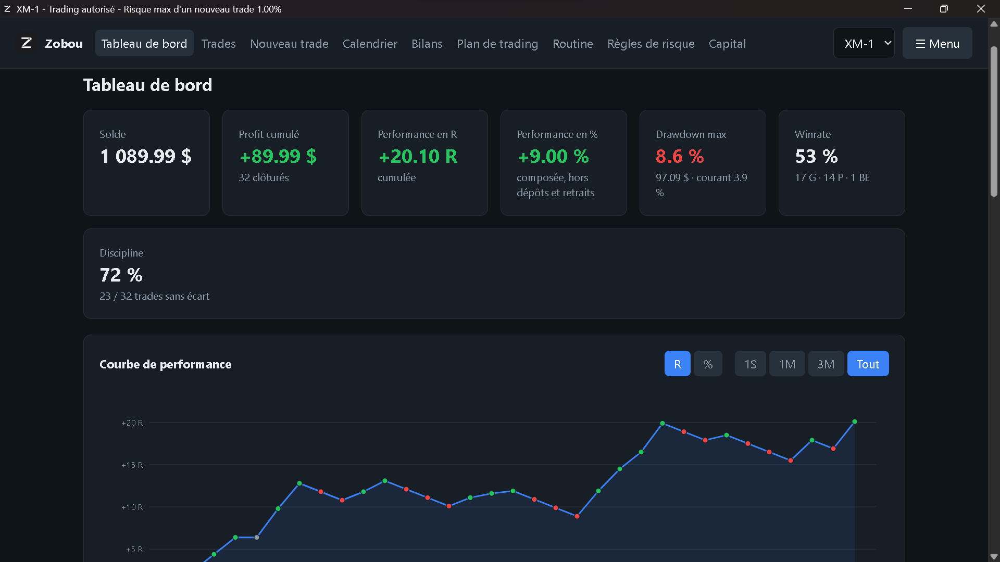
*The dashboard: balance, performance in R and %, max drawdown, win rate and discipline score.*

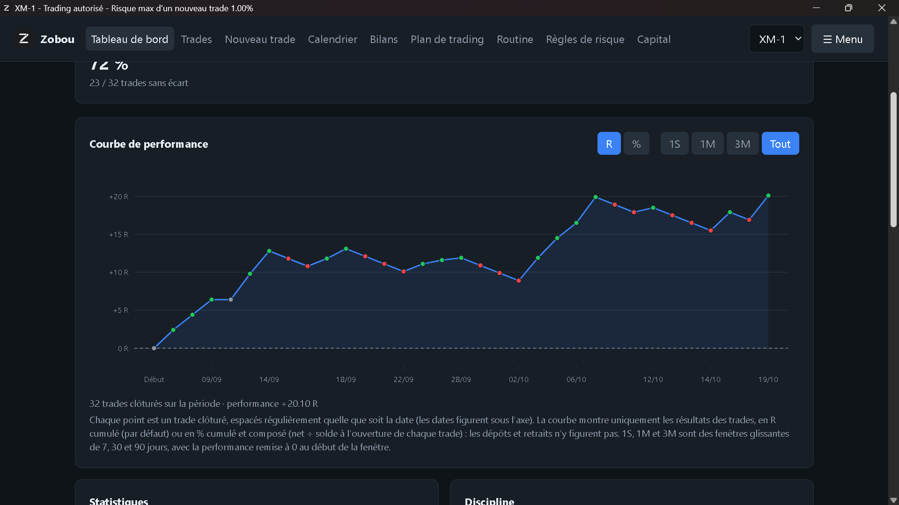
*The performance curve, in R or %, over 1 week, 1 month, 3 months or your whole history.*

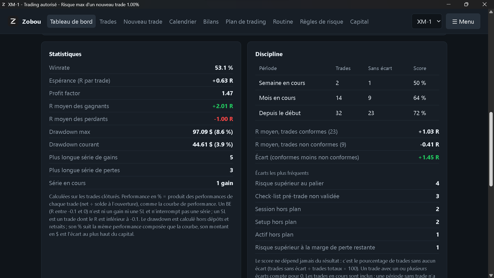
*Detailed statistics and discipline: average R of compliant versus non-compliant trades, and your most frequent deviations.*

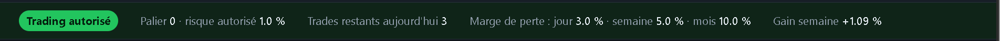
*The banner shown on every page: trading allowed or blocked, tier, remaining trades and loss margins.*

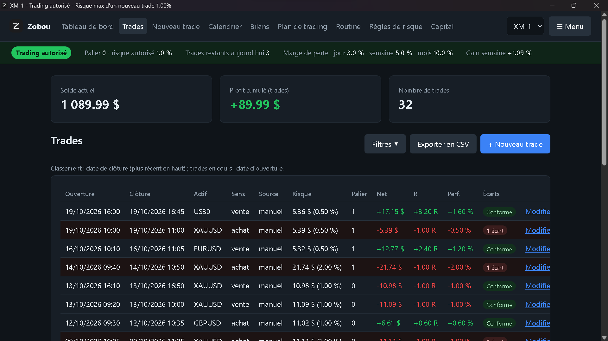
*The trade list, with the tier applied and the deviations of each trade.*

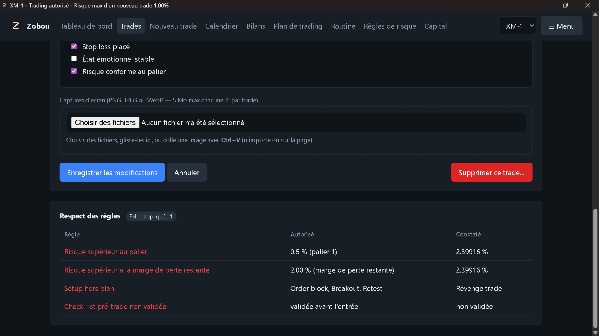
*A trade sheet: pre-trade checklist, screenshots and the detail of broken rules.*

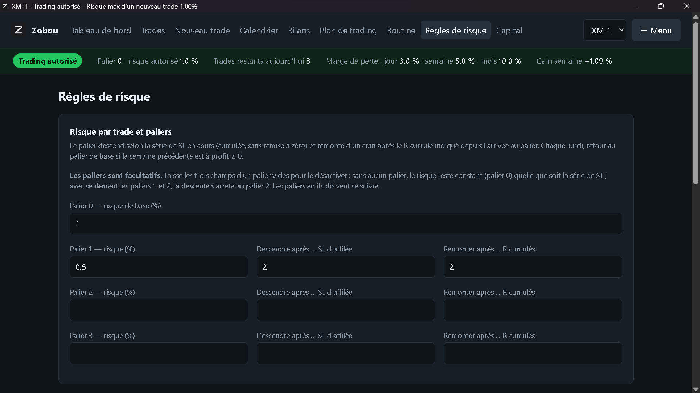
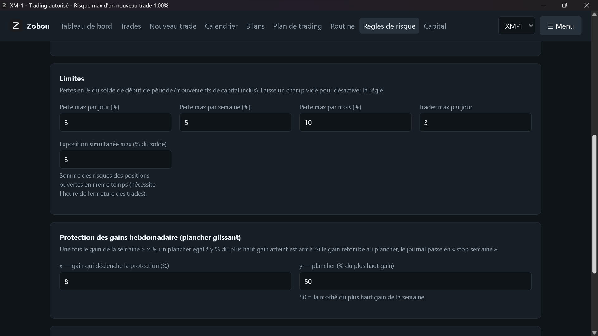
*Your risk rules: tiers, loss limits per day, week and month, weekly gain protection.*

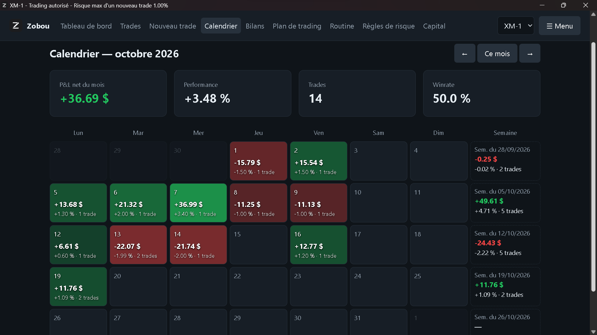
*The calendar: the result of each day and week at a glance.*

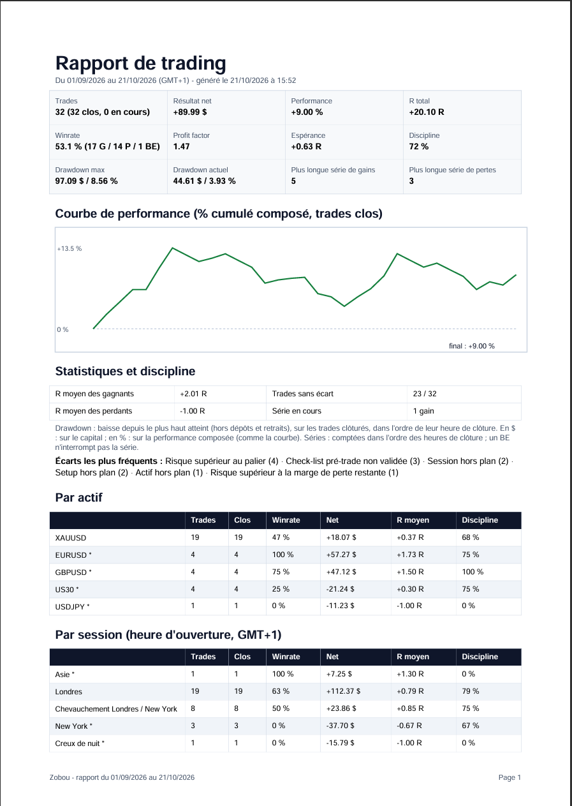

*The PDF report for any period you choose. Demo journal: all trades shown are fictitious.*

## What Zobou does for you

**Money management that is actually enforced**
- Base risk, 3 risk tiers (step down after a streak of stop-losses, step back up based on cumulative R), loss limits per day, week and month.
- Maximum trades per day, maximum simultaneous exposure, weekly protection (a trailing floor on your gains).
- A permanent banner shows whether trading is **allowed or blocked**, your current tier and the maximum risk of your next trade.
- Each trade is evaluated with the rules that applied on its date: history is never rewritten.

**A real measure of your discipline**
- Every trade gets a list of its deviations from your rules.
- A discipline score that is independent of results, and a comparison of average R between compliant and non-compliant trades.

**A complete dashboard**
- Interactive performance curve, balance, performance in R and %, drawdown, win rate, profit factor, expectancy.
- Breakdowns by asset, session, day, source and setup.

**A daily journal**
- Trading plan and pre-trade checklist, routine, rest days.
- Calendar, weekly and monthly reviews.
- Screenshots per trade (drag and drop or Ctrl+V).
- Open trades, move to BE, deposits and withdrawals.
- Multiple trading accounts and an "all accounts" view.

**Your data, under your control**
- Automatic daily backup, one-command restore.
- CSV exports (open correctly in Excel) and an A4 PDF report for any period you choose.
- Password-protected. Optional access from your smartphone over your own hotspot.
- Interface in **French or English** (chosen when you create the journal).

## How it works

1. **You contact me** and pay the current price (crypto or Mobile Money).
2. **You receive** the installer download link.
3. **You install** Zobou: on first launch it shows your computer ID (`ZB-XXXX-XXXX-XXXX-XXXX`). You send it to me.
4. **I send you back your access key**; you paste it into Zobou, then set your password and starting balance.

The key is tied to your computer and verified **offline**. No internet connection is needed to use Zobou.

**Updates:** your license includes new versions released within **12 months** of purchase. **After those 12 months, you keep access to your version and to every version you received during that period: they keep working with no time limit and no extra payment.** Only versions released after the 12 months require an extension.

**New computer or Windows reinstall:** send me the new `ZB-…` ID and I will generate a new key **for free, up to 2 times**. Beyond that, a reactivation fee applies.

> The installer is not publicly distributed: it is sent after payment.

## Requirements

- Windows 10 or 11 (64-bit)
- No Python installation needed

## Pricing

The price of Zobou goes up in steps, based on the number of licenses sold:

| Licenses sold | Price |
|---|---|
| 1 to 10 | **$30** (launch price) |
| 11 to 20 | $50 |
| 21 to 30 | $70 |
| … | +$20 after every 10 sales |
| from the 231st | **$490** (final price) |

- The price that applies is the one in force **on the day you order**.
- Once you have bought a license, **it never changes**: no extra fee, and your version stays usable forever.
- The current price is always shown at the top of this page.

## Purchase and contact

- **Order, questions, support:** [benjaminnkoa47@gmail.com](mailto:benjaminnkoa47@gmail.com) · WhatsApp: [+237 658 078 847](https://wa.me/237658078847)
- **Payment:** crypto (Bitcoin BTC, TRON TRX) for international customers, Mobile Money (MTN MoMo, Orange Money) in Cameroon

## Disclaimer

Zobou is a tracking and discipline tool. It does not provide investment advice and does not guarantee any result. Trading involves a risk of capital loss.

---

© Finova Capital · See [LICENSE.md](LICENSE.md)
